# 📈 SIP Retention AI Discovery Engine

[](https://YOUR-APP-NAME.streamlit.app)

**Live app:** https://YOUR-APP-NAME.streamlit.app  ← *replace after your first deploy (see below)*

A product-discovery tool from the Groww Growth team that mines **public** investor conversations to explain the **12-Month SIP Retention Cliff** — why first-time mutual-fund investors stop, pause or break their SIPs around the first anniversary — and maps each root cause to a compliant product intervention.

---

## 1. Problem framing

| | |
|---|---|
| **Cohort** | First-time mutual-fund investors on their first SIP |
| **Observed problem** | Disproportionate SIP cancellations, pauses and redemptions in months 10–14 |
| **North-Star metric** | ↑ Month-12 SIP retention (share of SIPs still active 12 months after activation) |
| **Discovery question** | Which root causes drive the cliff, how large is each, and how much is addressable by product? |
| **Constraints** | No fund/stock recommendations · no FOMO, fear or urgency nudges · public data only · zero PII |

### The 8 churn drivers

| Driver | What it looks like |
|---|---|
| Disappointment Valley | Flat or negative first-year returns read against FD/RD, “the SIP isn’t working” |
| Bank & Auto-Debit Friction | Mandate failures, bounce charges, bank-account changes |
| Same-Category Overlap | Several SIPs in one category with duplicated holdings, cancelled en masse |
| Directionless Onboarding | SIP started without a goal or horizon |
| Liquidity Shortage | Job change, rent, EMI, emergencies — only “continue” or “cancel” available |
| Market Correction Panic | First drawdown experienced as permanent loss |
| Social Influence | Peers/creators pushing stocks, F&O or crypto as “faster” |
| Platform Bugs | Wrong SIP status, units or NAV; slow support |

---

## 2. What the app does

- **Two ingestion modes**
  - **Benchmark Corpus (real public records)** — loads `real_benchmark_220.json`: verbatim, PII-scrubbed Play Store reviews and Reddit posts/comments, each with a link to the exact review or thread. Instant, zero-latency review for evaluators.
  - **Live Public Web Ingestion** — newest Google Play reviews (`google-play-scraper`) and public Reddit search JSON; no API keys or logins. If Reddit blocks or rate-limits the server (HTTP 403/429 or network refusal), the run automatically falls back to live Play Store ingestion.
- **Discovery table** with the exact 15-column schema and multi-select filters (Problem Theme, SIP Tenure, SIP Stage, Churn Preventability) plus free-text search.
- **Evaluator dashboard** (Plotly):
  1. The Month 10–14 drop-off cliff (tenure vs. churn volume)
  2. Root-cause driver breakdown (% share, avg SIP, dominant emotion)
  3. Churn preventability split + preventability by driver
- **PM Growth Roadmap** — SIP Sabbatical, Pre-Debit Balance Predictor, Same-Category Overlap Consolidator, and supporting features, each with compliance guardrails.
- **Excel export** — one click builds a 3-sheet workbook in memory:
  - `Discovery Dataset (N Rows)` — navy headers, auto-filters, frozen panes, wrapped comments (width 50), clickable source links
  - `Slide Deck Summary Metrics` — KPI block and pivots written as **live Excel formulas** over the dataset sheet, so filtering/editing rows in Excel updates the numbers
  - `PM Growth Roadmap` — feature specs, guardrails, success metrics, and evidence counts (also formulas)

### About the benchmark corpus

`real_benchmark_220.json` is produced by `harvest_real_data.py`, run once on your own machine:

- **Sources:** public Google Play reviews for Groww, Zerodha Coin and Kuvera; public posts **and comments** from r/IndiaInvestments, r/personalfinanceindia and r/mutualfunds matching SIP drop-off phrases.
- **Inclusion bar:** the text must mention SIPs/mutual funds, describe stopping, pausing, failing, redeeming or breaking, and score ≥ 3 on the churn-driver lexicon. Up to 220 of the most confidently classified items are kept. Themes are **not** rebalanced — the real distribution is the finding.
- **Links:** every record stores a post-level URL — `https://www.reddit.com/r/<sub>/comments/<id>/…` or `https://play.google.com/store/apps/details?id=<pkg>&reviewId=<id>`. Reddit links are re-checked before saving and dropped if removed or deleted. On load, the app also rejects any record without a post-level URL.
- **Text:** verbatim apart from PII placeholders (`[phone]`, `[user]`, …). Author names are never collected.
- **Labels:** machine-assigned by `engine_core.py`. Tenure and SIP amount are filled only when the author stated them, so the cliff chart uses that subset. Each record carries audit fields (`_matched_phrases`, `_theme_score`, `_posted_at`) for traceability.

If the file is missing, the app falls back to a clearly labelled **synthetic demo corpus** so it never shows an empty screen.

---

## 3. Architecture

```mermaid
flowchart LR
    subgraph Sources["Public sources (no auth)"]
        A[Google Play reviews<br/>google-play-scraper]
        B[Reddit public JSON<br/>/r/&lt;sub&gt;/search.json]
        C[real_benchmark_220.json<br/>harvested once, locally]
    end
    subgraph Engine["engine_core.py"]
        D[Sanitise<br/>strip handles, email, phone,<br/>PAN, Aadhaar, UPI, account nos.]
        E[Relevance filter<br/>SIP / MF / mandate terms]
        F[Enrich<br/>weighted-lexicon theme classifier<br/>+ tenure, amount, behaviour,<br/>emotion, preventability]
        G[summarize&#40;&#41;]
        H[build_discovery_workbook&#40;&#41;<br/>openpyxl, in-memory]
    end
    subgraph App["app.py (Streamlit)"]
        I[Control panel]
        J[Filters + 15-col table]
        K[Plotly dashboard]
        L[Roadmap]
        M[XLSX download]
    end
    A --> D
    B --> D
    D --> E --> F --> G
    C --> G
    I --> A & B & C
    G --> J & K & L
    G --> H --> M
```



```
.
├── app.py                  # Streamlit UI: header, control panel, filters, dashboard, roadmap, export
├── engine_core.py          # Ingestion, sanitisation, enrichment, benchmark loader, metrics, Excel builder (no Streamlit dependency)
├── harvest_real_data.py    # One-off local harvester that builds the real benchmark
├── real_benchmark_220.json # Real benchmark (commit this after harvesting)
├── requirements.txt
├── .streamlit/config.toml # Groww theme
└── README.md
```

**Enrichment approach.** Classification is a deterministic, explainable weighted-lexicon model (`engine_core.THEME_KB`): each theme has regex rules with weights, the highest-scoring theme wins above a minimum threshold, and unclassifiable or off-topic items are dropped and counted in the ingestion log. Tenure (“11 months”, “1.5 years”), SIP amount (“Rs 2,000”, “5k SIP”), behaviour (cancel / pause / redeem / reduce / switch), emotion and preventability are extracted with rules too. No API keys are needed, results are reproducible, and every label can be traced to the phrase that triggered it. To add an LLM pass later, wrap `enrich_record()` — the output schema stays the same.

`engine_core.py` also runs on its own:

```bash
python engine_core.py      # prints benchmark metrics and writes PM_Discovery_Workbook.xlsx
```

---

## 4. Compliance & data ethics

- **Public data only.** Play Store reviews and public Reddit posts; no logins, cookies, OAuth or private APIs.
- **Zero PII.** Reviewer names, avatars and Reddit authors are never read. Text is scrubbed of @handles, u/handles, emails, Indian mobile numbers, PAN, Aadhaar, UPI IDs, folio/client IDs and long digit strings before storage or display.
- **No advice.** Interventions never name a fund or security; historical context is factual and disclaimed.
- **No manipulative nudges.** No FOMO, fear or urgency copy; cancellation always stays one tap away (see guardrails per roadmap item).
- **Respectful scraping.** Small request volumes, a descriptive User-Agent, a pause between Reddit calls, and a 1-hour cache on live runs. Review each platform’s terms before scaling beyond discovery use.

**Known limitations.** Reddit throttles anonymous requests and often blocks cloud IP ranges, so on Streamlit Cloud Live mode frequently runs on Play Store data alone. The app stops calling Reddit at the first 403/429, falls back to Play Store automatically, and explains this in a notice and the ingestion log. Play Store package IDs are verified before scraping and re-resolved by name if wrong. Public reviews can be edited or deleted by their authors after harvest, so re-run the harvester before an important review. Play's `reviewId` links open the app's listing on the web with that review in focus; behaviour can vary by browser. Most public reviews don’t state tenure or SIP amount, so live charts use only records where they are stated.

---

## 5. Build the real benchmark (once, on your machine)

```bash
pip install -r requirements.txt
python harvest_real_data.py            # ~10–20 min; prints progress, resolved app IDs, theme mix
```

Useful flags: `--play-reviews 5000` (scan more reviews), `--min-score 2` (looser inclusion), `--skip-reddit`, `--app "Kuvera=com.pkg.id"`. Then open `real_benchmark_review.csv` and skim the labels. To fix one, add a row to `label_overrides.csv` (`source_id,action,value` with action `exclude` or `theme`) and re-run with `--reuse-raw` — no re-scraping needed. Commit `real_benchmark_220.json` when you're happy.

Run it from a home or office connection: Reddit is much more likely to block cloud servers.

---

## 6. Run locally

```bash
git clone https://github.com/<your-username>/sip-retention-engine.git
cd sip-retention-engine
python -m venv .venv && source .venv/bin/activate   # Windows: .venv\Scripts\activate
pip install -r requirements.txt
streamlit run app.py
```

Open http://localhost:8501.

---

## 7. Deploy to Streamlit Community Cloud (≈2 minutes)

1. **Push to GitHub** (including `real_benchmark_220.json`). Create a new **public** repository (e.g. `sip-retention-engine`) and push these files to `main`:
   ```bash
   git init && git add . && git commit -m "SIP Retention AI Discovery Engine"
   git branch -M main
   git remote add origin https://github.com/<your-username>/sip-retention-engine.git
   git push -u origin main
   ```
2. **Sign in** at [share.streamlit.io](https://share.streamlit.io) with GitHub and authorise access to the repo.
3. Click **Create app → Deploy a public app from GitHub**.
4. Set **Repository** = `<your-username>/sip-retention-engine`, **Branch** = `main`, **Main file path** = `app.py`.
5. *(Optional)* Under **App URL**, choose a custom subdomain, e.g. `groww-sip-retention`.
6. Click **Deploy**. The first build installs `requirements.txt` and takes about a minute.
7. Copy the live URL into the badge and **Live app** link at the top of this README, commit, and share it with evaluators.

No secrets are required. Every later push to `main` redeploys automatically.

---

*Internal product-discovery tool. Not investment advice. Mutual fund investments are subject to market risks; read all scheme-related documents carefully.*
